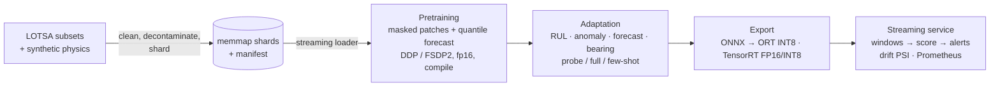

# SensorFM

A compact patch-based transformer foundation model for sensor time series — pretrained from
scratch, engineered for training throughput and fault tolerance, adapted to industrial tasks
(remaining-useful-life prediction, anomaly detection, forecasting, bearing faults), and deployed as
INT8 models behind a streaming scoring service. Three sizes: s20m / m60m / l150m (exact parameter
counts in the generated "Model sizes" table below; the names follow the plan, the counts are
smaller).

**$0 compute**: CPU locally, Kaggle Notebooks (free T4 ×2 / P100) for GPU work —
[ADR 000](docs/decisions/000-free-tier-compute.md).

> **Status (generated sections below are the source of truth):** data, model, training loop,
> distributed training, fine-tuning, export and serving are implemented and tested on CPU. GPU
> pretraining, scaling and deployment benchmarks are waiting for Kaggle runs
> ([Checkpoint 1](docs/checkpoints/checkpoint1.md), [Checkpoint 2](docs/checkpoints/checkpoint2.md)).
> Targets live in [docs/targets.md](docs/targets.md) and are **not** results.



## Key decisions

- **One forward pass, two objectives**: random context patches and the forecast horizon are both
  hidden behind a mask token; RevIN statistics use only visible points, so no target information
  leaks (tested). [model/sensorfm.py](src/sensorfm/model/sensorfm.py)
- **Exact resumption**: a SIGKILLed run resumes bit-identically (single process, DDP and FSDP2 with
  sharded DCP checkpoints) — essential when every GPU session has a time limit.
  [ADR 002](docs/decisions/002-distributed.md)
- **Honest evaluation**: decontamination against every downstream series (window hashing), splits
  by unit/load/series never by window, UCR scored with the archive's own rule (no point-adjust),
  paired bootstrap for claimed differences, fallbacks and skipped baselines always reported.
  [dataset card](docs/dataset_card.md)
- **Downstream heads get RevIN level/scale back**: per-window normalization erases exactly the
  slow level drift that RUL depends on.

## Quickstart

```bash
make setup          # uv venv + core/dev deps (CPU torch)
make test           # fast tests (make test-all adds crash-resume + distributed tests)
make pretrain-debug # synthetic shards + tiny model on CPU, ~10 s
make report         # regenerate the results block below from results/
```

GPU work: [kaggle/README.md](kaggle/README.md). Layout: [plan.md](plan.md) §2.

## What I'd do next

Run the Kaggle plan in Checkpoint 2; then the ablations E1–E7 (`kaggle/run_ablations.sh`), a
Triton kernel only if the profile shows an unfused hotspot (Task 3.4), and a 5th non-LOTSA
forecasting dataset.

## Results (generated by `scripts/build_report.py`)

<!-- RESULTS:START -->
### Model sizes

| Config | Parameters | Non-embedding | Train FLOPs / token |
|---|---|---|---|
| tiny | 114,722 | 112,674 | 7.01e+05 |
| s20m | 14,283,426 | 14,271,138 | 8.62e+07 |
| m60m | 50,555,042 | 50,538,658 | 3.05e+08 |
| l150m | 127,756,962 | 127,732,386 | 7.69e+08 |

<sub>Source: `results/model/params.json`</sub>

### Forecasting — baselines (ETT, H=96, context 512)

MASE scaled by in-sample seasonal-naive MAE on the training split; WQL scale-free. SensorFM sees context_length − H points.

| Method | ETTh1 MASE | ETTh2 MASE | ETTm1 MASE | ETTm2 MASE | mean MASE | gmean MASE | mean WQL | fallbacks |
|---|---|---|---|---|---|---|---|---|
| seasonal_naive | 1.084 | 1.292 | 0.950 | 1.037 | 1.091 | 1.044 | 0.328 | 0/2100 |
| ets | 1.111 | 1.256 | 1.644 | 0.944 | 1.239 | 1.077 | 0.394 | 0/2100 |

<sub>Source: `results/eval/forecast_baselines.json`</sub>

### C-MAPSS classic baselines (W=30, 3 seeds)

Official last-cycle test RUL (uncapped); validation split by engine unit.

| Subset | Model | RMSE (mean ± std) | NASA score (mean ± std) |
|---|---|---|---|
| FD001 | gbm | 14.62 ± 0.07 | 309 ± 0 |
| FD001 | lstm | 15.76 ± 0.57 | 499 ± 111 |
| FD001 | cnn | 15.15 ± 0.03 | 408 ± 11 |
| FD002 | gbm | 26.42 ± 0.02 | 7408 ± 99 |
| FD002 | lstm | 26.42 ± 0.51 | 9070 ± 1158 |
| FD002 | cnn | 27.53 ± 0.38 | 11417 ± 1573 |
| FD003 | gbm | 14.90 ± 0.03 | 445 ± 3 |
| FD003 | lstm | 16.36 ± 0.95 | 761 ± 299 |
| FD003 | cnn | 15.94 ± 0.27 | 518 ± 52 |
| FD004 | gbm | 26.80 ± 0.09 | 4636 ± 51 |
| FD004 | lstm | 27.12 ± 0.42 | 6684 ± 2134 |
| FD004 | cnn | 28.62 ± 0.23 | 6313 ± 387 |

<sub>Source: `results/eval/cmapss_baselines.json`</sub>

### C-MAPSS classic baselines, few-shot (10% of training units)

| Subset | Model | RMSE (mean ± std) | NASA score (mean ± std) |
|---|---|---|---|
| FD001 | gbm | 19.39 ± 0.75 | 941 ± 98 |
| FD001 | lstm | 21.78 ± 1.19 | 1309 ± 220 |
| FD001 | cnn | 19.64 ± 1.37 | 1043 ± 577 |
| FD002 | gbm | 28.22 ± 0.32 | 14974 ± 3508 |
| FD002 | lstm | 29.31 ± 0.41 | 12826 ± 2091 |
| FD002 | cnn | 28.88 ± 0.08 | 12906 ± 1522 |
| FD003 | gbm | 18.90 ± 2.17 | 2015 ± 1381 |
| FD003 | lstm | 24.32 ± 1.59 | 4370 ± 3339 |
| FD003 | cnn | 24.85 ± 1.26 | 6162 ± 5423 |
| FD004 | gbm | 28.26 ± 0.19 | 5919 ± 335 |
| FD004 | lstm | 31.24 ± 0.97 | 8229 ± 1204 |
| FD004 | cnn | 30.82 ± 0.54 | 8826 ± 573 |

<sub>Source: `results/eval/cmapss_baselines_fewshot10.json`</sub>

### RUL paired comparisons (bootstrap over engines, seed-averaged predictions)

| Subset | A | B | RMSE A | RMSE B | A−B (95% CI) | significant |
|---|---|---|---|---|---|---|
| FD001 | lstm | gbm | 15.29 | 14.60 | +0.69 [-0.96, +2.22] | no |
| FD002 | lstm | gbm | 26.21 | 26.38 | -0.17 [-1.14, +0.76] | no |
| FD003 | lstm | gbm | 15.41 | 14.89 | +0.51 [-1.46, +2.50] | no |
| FD004 | lstm | gbm | 26.86 | 26.79 | +0.07 [-0.93, +1.06] | no |
| FD001 | cnn | gbm | 14.76 | 14.60 | +0.16 [-1.62, +1.88] | no |
| FD002 | cnn | gbm | 27.25 | 26.38 | +0.86 [-0.17, +1.92] | no |
| FD003 | cnn | gbm | 15.61 | 14.89 | +0.72 [-1.80, +3.31] | no |
| FD004 | cnn | gbm | 28.37 | 26.79 | +1.58 [+0.66, +2.57] | yes |

<sub>Source: `results/eval/rul_analysis.json`</sub>

### Scaling (Kaggle T4)

*Pending — `results/scaling` not produced yet.*

### Crash-resume test (CPU)

- killed after step 25, resumed from 20 (5 steps lost); first new step 1.40 s after restart; all logged losses identical to the uninterrupted run.

<sub>Source: `results/resume_test.json`</sub>

### Distributed correctness (CPU, gloo, 2 processes)

- max |loss difference| vs single process: DDP 2.4e-07, FSDP2 2.4e-07 over 10 steps

<sub>Source: `results/scaling/parity_cpu_gloo.json`</sub>

<!-- RESULTS:END -->
