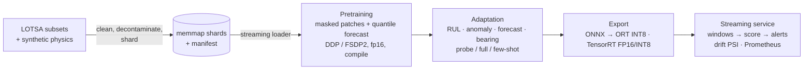

# SensorFM

A compact patch-based transformer foundation model for sensor time series — pretrained from
scratch, engineered for training throughput and fault tolerance, adapted to industrial tasks
(remaining-useful-life prediction, anomaly detection, forecasting, bearing faults), and deployed as
INT8 models behind a streaming scoring service. Three sizes: s20m / m60m / l150m (exact parameter
counts in the generated "Model sizes" table below; the names follow the plan, the counts are
smaller).

**$0 compute**: CPU locally, Kaggle Notebooks (free T4 ×2 / P100) for GPU work —
[ADR 000](docs/decisions/000-free-tier-compute.md).

> **Status (generated sections below are the source of truth):** data, model, training loop,
> distributed training, fine-tuning, export and serving are implemented and tested on CPU. GPU
> pretraining, scaling and deployment benchmarks are waiting for Kaggle runs
> ([Checkpoint 1](docs/checkpoints/checkpoint1.md), [Checkpoint 2](docs/checkpoints/checkpoint2.md)).
> Targets live in [docs/targets.md](docs/targets.md) and are **not** results.



## Key decisions

- **One forward pass, two objectives**: random context patches and the forecast horizon are both
  hidden behind a mask token; RevIN statistics use only visible points, so no target information
  leaks (tested). [model/sensorfm.py](src/sensorfm/model/sensorfm.py)
- **Exact resumption**: a SIGKILLed run resumes bit-identically (single process, DDP and FSDP2 with
  sharded DCP checkpoints) — essential when every GPU session has a time limit.
  [ADR 002](docs/decisions/002-distributed.md)
- **Honest evaluation**: decontamination against every downstream series (window hashing), splits
  by unit/load/series never by window, UCR scored with the archive's own rule (no point-adjust),
  paired bootstrap for claimed differences, fallbacks and skipped baselines always reported.
  [dataset card](docs/dataset_card.md)
- **Downstream heads get RevIN level/scale back**: per-window normalization erases exactly the
  slow level drift that RUL depends on.

## Quickstart

```bash
make setup          # uv venv + core/dev deps (CPU torch)
make test           # fast tests (make test-all adds crash-resume + distributed tests)
make pretrain-debug # synthetic shards + tiny model on CPU, ~10 s
make report         # regenerate the results block below from results/
```

GPU work: [kaggle/README.md](kaggle/README.md). Layout: [plan.md](plan.md) §2.

## What I'd do next

Run the Kaggle plan in Checkpoint 2; then the ablations E1–E7 (`kaggle/run_ablations.sh`), a
Triton kernel only if the profile shows an unfused hotspot (Task 3.4), and a 5th non-LOTSA
forecasting dataset.

## Results (generated by `scripts/build_report.py`)

<!-- RESULTS:START -->
### Model sizes

| Config | Parameters | Non-embedding | Train FLOPs / token |
|---|---|---|---|
| tiny | 114,722 | 112,674 | 7.01e+05 |
| s20m | 14,283,426 | 14,271,138 | 8.62e+07 |
| m60m | 50,555,042 | 50,538,658 | 3.05e+08 |
| l150m | 127,756,962 | 127,732,386 | 7.69e+08 |

<sub>Source: `results/model/params.json`</sub>

### Forecasting baselines (ETT, H=96, context 512)

*Pending — `results/eval/forecast_baselines.json` not produced yet.*

### C-MAPSS classic baselines (W=30, 3 seeds)

*Pending — `results/eval/cmapss_baselines.json` not produced yet.*

### Scaling (Kaggle T4)

*Pending — `results/scaling` not produced yet.*

### Crash-resume test (CPU)

- killed after step 25, resumed from 20 (5 steps lost); first new step 0.95 s after restart; all logged losses identical to the uninterrupted run.

<sub>Source: `results/resume_test.json`</sub>

### Distributed correctness (CPU, gloo, 2 processes)

- max |loss difference| vs single process: DDP 2.4e-07, FSDP2 2.4e-07 over 10 steps

<sub>Source: `results/scaling/parity_cpu_gloo.json`</sub>

<!-- RESULTS:END -->
